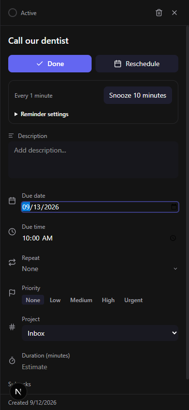

# Todoer

A task manager with reminders that keep nagging you until you deal with the task.

**Live app:** https://todoer-ruby.vercel.app



## What it does

- Add tasks in plain language, such as "Call the dentist tomorrow at 10am p1 #health @calls". The app reads the date, time, priority, project, label and repeat pattern.
- Turn on a persistent reminder for a task. It repeats at a set interval until you complete, snooze or reschedule the task.
- Organize work with projects, labels, subtasks, recurring tasks and drag-and-drop ordering.
- Plan with Today, Upcoming, Calendar and priority-matrix views. A focus timer, habit tracker and stats page are also included.

## Tech stack

- [Next.js](https://nextjs.org) (App Router, static export) with React and TypeScript
- [Supabase](https://supabase.com) for the Postgres database, authentication and row-level security
- [Tailwind CSS](https://tailwindcss.com) for styling
- TanStack Query and Zustand for data and UI state
- chrono-node and rrule for date parsing and recurring tasks
- [Capacitor](https://capacitorjs.com) to package the same web app for iOS and Android
- Vitest for unit tests, with GitHub Actions running checks
- Hosted on Vercel

Built with [Claude Code](https://claude.com/claude-code).

## Run it locally

You need Node.js 22 or later and a Supabase project. Apply the SQL files in [supabase/migrations](supabase/migrations) to create the tables and security rules.

1. Install dependencies:

   ```bash
   npm install
   ```

2. Create a file named `.env.local` with your Supabase project URL and public anon key:

   ```
   NEXT_PUBLIC_SUPABASE_URL=https://your-project.supabase.co
   NEXT_PUBLIC_SUPABASE_ANON_KEY=your-anon-key
   ```

3. Start the dev server and open http://localhost:3000:

   ```bash
   npm run dev
   ```

Run the tests and type check with `npm test` and `npm run typecheck`.

### Mobile builds

- Android: `npm run cap:android` builds the web app, syncs it into the Android project and opens Android Studio.
- iOS (needs a Mac with Xcode): `npm run ios:prepare`, then `npm run ios:open`. The `Check iPhone build` GitHub Actions workflow compiles an unsigned build when you start it by hand.

## Project docs

- [SPEC.md](SPEC.md): the original product and technical specification.
- [docs/plans](docs/plans): the design for the native mobile apps.
